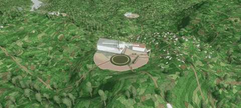
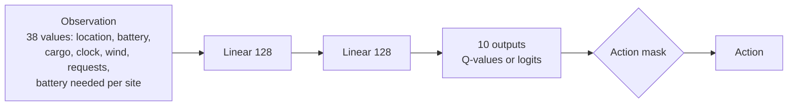

# Reinforcement Learning: Medical Drone Delivery

Reinforcement learning agents, trained with TorchRL, that dispatch a medical delivery drone across the hills of Muhanga District, Rwanda. The best agent (PPO) scores +55.6 per shift on days it never trained on, against +41.4 for a hand-written dispatcher, and keeps +46.7 on a busy day when the dispatcher falls to +5.4.



## Project

Shima Serein. Summative assignment, Mission-Based Reinforcement Learning, Machine Learning Techniques, African Leadership University.

One drone works an 8-hour shift from a hub. Six rural health centres send requests for blood and emergency medicine at random times, each with a deadline: 45 minutes for an emergency, 120 for routine. The agent is the hub's flight controller. Each decision (fly to a centre and drop a package, return, load, recharge, hold) changes what it can do next, because battery, cargo, open requests and the drone's position all carry over.

It gets +10 for an emergency delivered in time and +4 for a routine one, −10 and −3 for a missed deadline, −15 for ending the shift away from the hub, and a crash costs −40 plus every request the grounded service will now miss. [docs/environment.md](docs/environment.md) has the full action, observation and reward tables.

## Agents



Four agents learn on the same environment: DQN (value-based) and REINFORCE, PPO and A2C (policy gradient), each with TorchRL's own modules and losses. The policy-gradient agents also train a value network of the same shape. [docs/architecture.md](docs/architecture.md) shows the training loops.

## Results

| Method | Normal day | Busy day | Windy day | Matched the dispatcher |
|---|---|---|---|---|
| **PPO** (run 9) | **+55.6** | **+46.7** | +53.4 | 9 of 10 runs |
| DQN (run 8) | +51.3 | +36.4 | **+56.8** | 10 of 10 runs |
| A2C (run 8) | +49.4 | +37.7 | +50.8 | 4 of 10 runs |
| REINFORCE (run 2) | +36.8 | +9.3 | +39.0 | 1 of 10 runs |
| Hand-written dispatcher | +41.4 | +5.4 | +37.8 | |

Mean return over 20 shifts with seeds training never used. A busy day has 50% more requests and a windy day 60% stronger wind; neither was seen in training.

PPO was the best and the most reliable, DQN learned fastest, and A2C and REINFORCE were fragile: 4 A2C runs and 2 REINFORCE runs collapsed into holding at the hub all shift. [docs/results.md](docs/results.md) has the learning curves, DQN's loss, the policy entropy and the generalisation test. Each algorithm's 10 experiments have their own file with what each run did ([DQN](results/DQN_hyperparameter_experiment_results.md), [PPO](results/PPO_hyperparameter_experiment_results.md), [A2C](results/A2C_hyperparameter_experiment_results.md), [REINFORCE](results/REINFORCE_hyperparameter_experiment_results.md)), with an overview in [docs/experiments.md](docs/experiments.md).

## Demonstration

`main.py` plays the agent in a three.js viewer: the hills, the hub and health centres, request beacons (red for emergency, amber for routine), the drone's flights and parachute drops, a sun that follows the shift clock, and wind you can see in the trees and crops. The terminal prints every decision. A full shift: [drone-delivery-shift.mp4](videos/drone-delivery-shift.mp4).

## Quick start

```bash
uv sync                                                     # install
uv run main.py                                              # watch the best agent (PPO) in the 3D viewer
uv run main.py --algo dqn                                   # another agent: dqn, a2c, reinforce, heuristic
uv run main.py --config busy --no-viewer --fast --episodes 20   # test on 20 busy days, terminal only
uv run python -m training.pg_training --algo ppo --sweep --jobs 2   # retrain PPO's 10 experiments
uv run python -m training.analyze                           # rebuild the figures and tables
uv run pytest                                               # environment tests
```

## Repository layout

```text
main.py, play.py    run the best agent in the 3D viewer (play.py calls main.py)
environment/        the Gymnasium environment, the viewer server and the three.js viewer
training/           TorchRL training for DQN and the policy-gradient methods, sweeps, analysis
models/             every run's weights: dqn/ and pg/, with the best of each in <algo>_best/
logs/               every run's metrics and evaluation, sweep tables, demo shift logs
results/            each algorithm's experiment table and observations
assets/             figures and generated tables
docs/               environment, agent architecture, experiments, results, video script
videos/             the agent's preview and a full shift
tests/              environment tests
```

[ARCHITECTURE.md](ARCHITECTURE.md) maps the code module by module.
