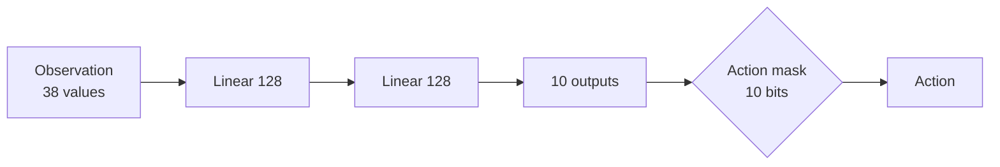
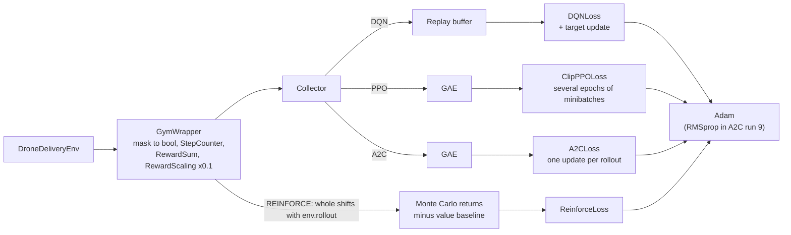

# Agent architecture

All four agents read the same 38 observation values and choose among the same 10 actions, and all use small multilayer perceptrons built with TorchRL. The action mask is applied after the network, so an agent never picks a command the flight controller would refuse.

## Networks

| Agent | Output of the network | Activation | Second network | How the action is chosen |
|---|---|---|---|---|
| DQN | a Q-value for each action | ReLU | a target copy of the Q-network | highest masked Q-value (epsilon-greedy while training) |
| REINFORCE | a logit for each action | Tanh | value network (38 → 128 → 128 → 1) used as a baseline | sampled from `MaskedCategorical` while training, most likely action when playing |
| PPO | a logit for each action | Tanh | value network (critic) | as REINFORCE |
| A2C | a logit for each action | Tanh | value network (critic) | as REINFORCE |

DQN run 9 and A2C run 8 use 256 units instead of 128.

## Training loops

- **DQN** stores every step in a replay buffer and learns from random batches with the target `r + gamma * max Q_target(s', a')`, masked to allowed actions. The target network is copied every 500 updates (hard) or blended in a little every update (soft). Double DQN chooses the next action with the online network and scores it with the target network.
- **PPO** collects 2,048 steps, computes advantages with generalised advantage estimation (GAE), then trains for 4 epochs on minibatches of 256 with the clipped objective, a critic loss and an entropy bonus.
- **A2C** collects 256 steps and makes a single update from GAE advantages, with a critic loss and an entropy bonus.
- **REINFORCE** plays 8 whole shifts, computes each step's discounted return to the end of the shift, subtracts the critic's estimate (in most runs) and normalises the result, then makes one update.

Every 5,000 steps the training scripts play the greedy policy on 5 held-out seeds, and at the end on 20 more under each day type. [experiments.md](experiments.md) lists the hyperparameters.

## TorchRL pieces

| Piece | Used for |
|---|---|
| `GymWrapper`, `TransformedEnv`, `DTypeCastTransform`, `StepCounter`, `RewardSum`, `RewardScaling` | wrapping the Gymnasium environment |
| `Collector` | collecting frames for DQN, PPO and A2C |
| `QValueActor`, `EGreedyModule` | DQN's policy and exploration, both mask-aware |
| `ProbabilisticActor`, `MaskedCategorical`, `ValueOperator` | the policy-gradient actor and critic |
| `TensorDictReplayBuffer`, `LazyTensorStorage`, `SamplerWithoutReplacement` | DQN's replay buffer and PPO's minibatches |
| `DQNLoss`, `HardUpdate`, `SoftUpdate` | DQN |
| `ClipPPOLoss`, `A2CLoss`, `ReinforceLoss`, `GAE` | the policy-gradient methods |
