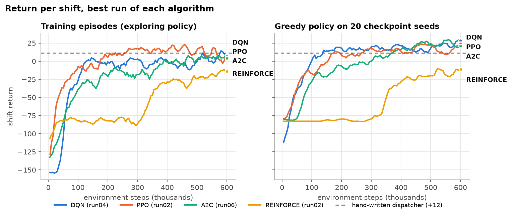
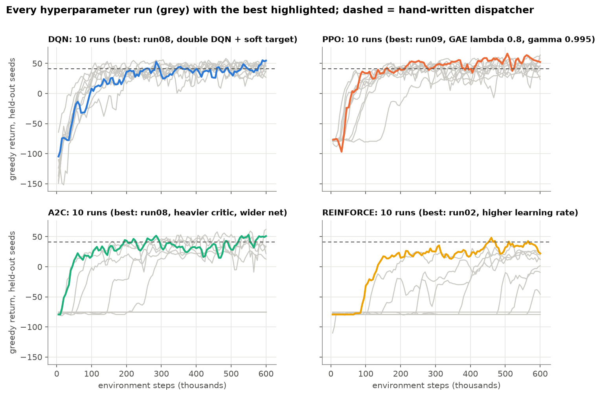
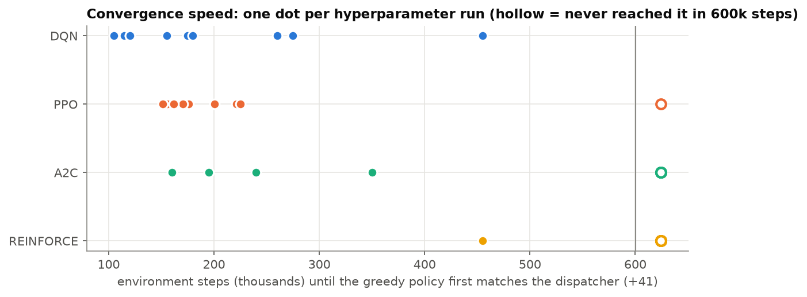
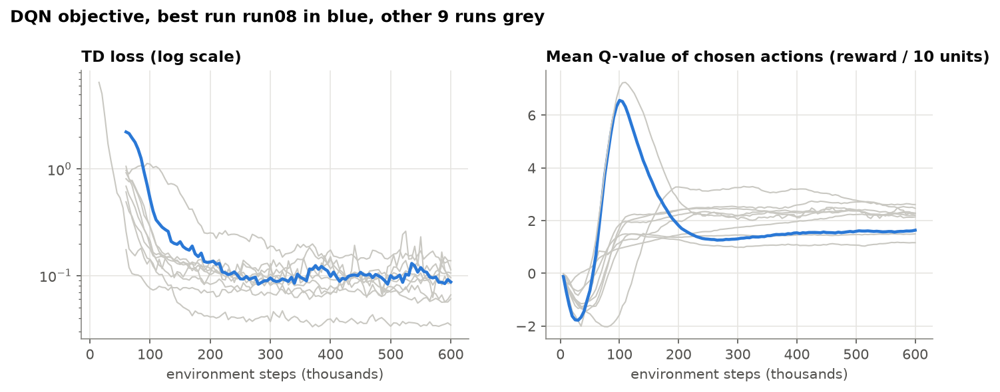
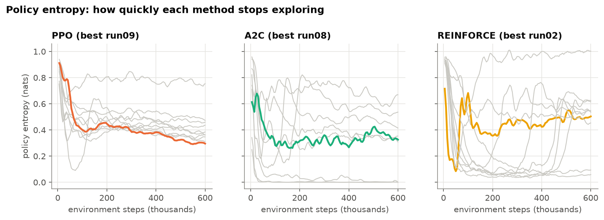
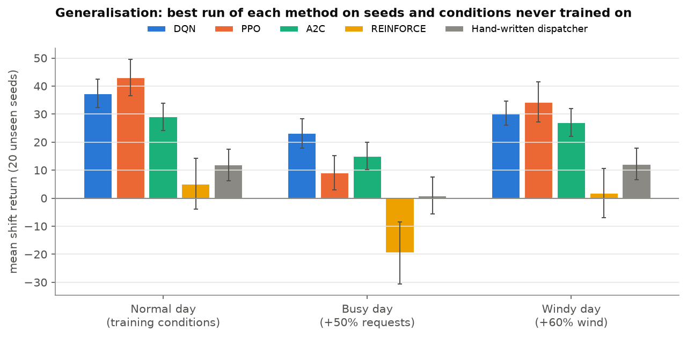

# Results

The best run of each algorithm, playing greedily on 20 shifts it never trained on (mean return ± standard deviation):

| Method | Best run | Normal day | Busy day (+50% requests) | Windy day (+60% wind) | Requests served | Crashes |
|---|---|---|---|---|---|---|
| **PPO** | run 9: GAE lambda 0.8, gamma 0.995 | **+55.6** ± 19.1 | **+46.7** | +53.4 | 68% | 0 of 20 |
| DQN | run 8: double DQN, soft target | +51.3 ± 19.5 | +36.4 | **+56.8** | 67% | 1 of 20 |
| A2C | run 8: heavier critic, wider network | +49.4 ± 26.9 | +37.7 | +50.8 | 67% | 1 of 20 |
| REINFORCE | run 2: higher learning rate | +36.8 ± 22.2 | +9.3 | +39.0 | 64% | 1 of 20 |
| Hand-written dispatcher | | +41.4 ± 26.8 | +5.4 | +37.8 | 69% | 0 of 20 |
| Always hold | | −83.4 | −118.4 | −83.4 | 0% | 0 of 20 |
| Random (allowed actions) | | −157.9 | −205.2 | −156.6 | 23% | 20 of 20 |

`main.py` plays the PPO agent, [`models/pg/ppo_best/`](../models/pg/ppo_best). The other three are in `models/dqn/dqn_best/` and `models/pg/<algo>_best/`.

## Learning curves



The left panel is the return of the shifts played while training, including exploration; the right is the greedy policy on 5 held-out seeds every 5,000 steps. All four start well below zero: early random flights strand or crash the drone. The best PPO, A2C and DQN runs first match the dispatcher's level (dashed) at 161,000, 195,000 and 260,000 steps. REINFORCE stays flat at about −80 for its first 90,000 steps, because it only learns from whole shifts, then climbs more slowly.

## Every run



DQN's and PPO's 10 runs bunch together: almost every setting works. A2C's and REINFORCE's spread out, and several lie flat at about −80: those runs collapsed into holding at the hub all shift, which scores −83.4 on every seed. [The experiment files](../results/) explain each run.

## How quickly each method converges



All 10 DQN runs and 9 of 10 PPO runs matched the dispatcher, most within 105,000 to 230,000 steps. Only 4 A2C runs and 1 REINFORCE run did.

## DQN's objective



The TD loss falls by an order of magnitude in the first 200,000 steps and then levels off near 0.1. The best run (double DQN with a soft target) overestimated early, with Q-values peaking at 6.6 around 100,000 steps before settling at 1.6, and run 9's frequent target copies pushed them to 7.2. The other runs stay between about 1 and 3.3.

## Policy entropy



PPO's entropy falls from about 0.9 to between 0.3 and 0.5 in every run except the one with a strong entropy bonus, even with no bonus at all: its clipped updates stop the policy becoming certain too fast. In A2C and REINFORCE, the runs whose entropy reaches zero are the runs that collapsed. A strong entropy bonus keeps entropy high (0.65 in A2C, 1.0 in REINFORCE), which saved A2C but kept REINFORCE too random.

## Generalisation



On a normal day the three best learners beat the dispatcher. On a busy day the difference grows: the dispatcher drops to +5.4, while PPO keeps +46.7 and DQN and A2C stay near +37. Stronger wind hardly changes anyone's score: every method stays within 6 points of its normal-day return.

PPO does not copy the dispatcher's habits. On the 20 test shifts it leaves the hub with a single package about half the time, where the dispatcher always waits to load two, and it recharges earlier, at 54% battery on average against the dispatcher's 41%.

## Limits

- Every run is a single training seed. With returns varying by 15 to 30 points from shift to shift, a difference of less than about 5 points between two runs is within noise.
- The best runs of DQN, A2C and REINFORCE each crashed in 1 of their 20 test shifts. PPO's best never did.
- The map, demand rates and energy model are stylised, so these scores compare methods with each other, not with a real drone service.

To repeat the evaluation:

```bash
uv run main.py --no-viewer --fast --episodes 20              # PPO on seeds 10000-10019
uv run main.py --algo heuristic --no-viewer --fast --episodes 20
uv run main.py --config busy --no-viewer --fast --episodes 20
```
